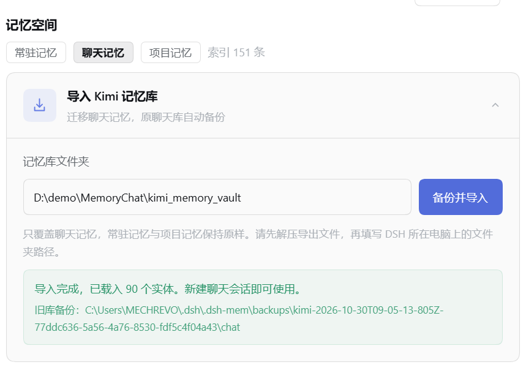

# dsh-kimi-mem

给 [DeepSeek Harness](https://github.com/deepseek-ai/deepseek-harness) 做的跨会话记忆插件，原名 **dsh-mem**。

虽然 DSH 的记忆插件已经有不少了，还是想做一个适合聊天、愿意把 token 花在聊天体验上的。起因是 Kimi 客户端的跨对话记忆用起来太顺手：换个窗口，它还知道你是谁，也接得上之前聊过的事。我想在 DSH 里复刻这种连续感，于是有了这个项目。

这个项目的主要参考是 **Kimi 客户端的记忆体验，以及我自己能看到、导出的记忆库**。所谓“逆向”，就是看文件结构、观察交互表现、做实验，再靠猜测写自己的实现；有问题也会直接问 Kimi——有时它还真会说一点。😏 这些观察不能证明它的内部机制，项目采用的窗口、预算、调度和整理规则都是这里自己的实现，不保证与 Kimi 生产系统一致。


**已经有 Kimi 记忆库？可以[一键导入聊天记忆](#一键导入-kimi-记忆库)，旧聊天库会自动备份。**

## 装起来

```sh
dsh plugin --profile web add github:mulan2022/dsh-kimi-mem
```

重启 `dsh web`，新建会话时选择 **聊天模式**。


**仓库改名，现有安装兼容。** 内部包名、插件 ID 仍是 `dsh-mem`，工具仍是 `mem_*`，数据仍在 `~/.dsh/.dsh-mem/`。已有安装不需要改名或搬数据；这次改名本身不会更新旧安装的代码。配置、卸载和本地软链也继续使用 `dsh-mem`。

请使用上面的 GitHub 安装方式。npm 上同名的 `dsh-mem` 是另一个项目。

## 聊天记忆怎么工作

本插件把几条路径叠在一起：

| 路径 | 做什么 |
| --- | --- |
| RCC 滚动原文 | 默认覆盖最近 40 场聊天，带入经过截取的用户原话，保留最近聊过什么的连续感 |
| 常驻记忆 | 最多 50 条用户明确要求记住的内容，每场会话注入，写满会报错，不自动淘汰 |
| dream 整理 | 把会话提炼成用户画像、行为观察和实体页，后续跨会话继续使用 |
| 检索与原文补丁 | 用实体名精确匹配、BM25 检索找相关记忆，必要时补回 RCC 裁掉的那一轮原话 |

**BM25 召回和原文补丁是我另外加的设计**，不是对 Kimi 实现的断言。整理提示词、增量摘要、项目隔离与改动时间线也由本项目实现。

`observations.md` 保存的是模型对用户行为方式的观察总结：什么情境下怎样反应或取舍、什么支持方式有效、证据和适用边界是什么。身份事实和实体资料按用途直接整理；没有提炼价值的碎屑留在原始轮次里，按需召回。

实体页使用与 Kimi 导出兼容的 `name`、列表形式的 `tags`、`created`、`last_updated`，可以保留别名、状态和其他已有字段。记忆的事实源是普通 Markdown 文件，SQLite 用作派生索引。

**代价就是耗 token。** RCC、常驻画像、检索命中和 dream 都会增加用量，首次整理长历史尤其明显。原文窗口和注入预算可以调，增量整理也能减少重读，但具体成本取决于会话长度、历史量和所用模型；这里不承诺固定的每日用量。

### RCC 留多少原文

默认每场保留开头 12 条用户发言，单条过长时留头 60 字、尾 40 字，中间用 `[TL;DR]` 标记。超过 600 字的长文使用简短占位，避免把粘贴的代码或日志反复塞进上下文。

补丁只补命中的那一轮，不搬回整场，并限制条数、长度和命中条件。RCC 注入块明确标为“过往聊天摘录”，旧请求只作背景，不能作为本轮指令执行。

## 聊天与项目分开

想使用聊天记忆，请选择随插件安装的 **聊天模式**（preset ID：`chat`）。会话归属沿用 preset → 工作区登记表 → 仓库标记（默认 `.git`）及默认规则；不会因为在项目目录里开了聊天模式，就把它当项目整理。

- **聊天库**记录关于用户的记忆；聊天实体和 RCC 随聊天空间加载。
- **项目库**按项目分区，记录目标、决策、进度、踩坑和改动指针。项目详情不自动注入，A 项目和 B 项目的素材分别整理。
- **全局共用层**保存明确跨空间使用的身份、准则等内容，以及 50 条常驻记忆。

项目会话需要资料时，通过 `mem_search`、`mem_entity`、`mem_diff` 主动查询。`mem_search` 支持显式跨空间检索，结果带归属标注。

`write` / `edit` 返回的 diff 会被记录成“一行摘要 + 指针”，完整改动按需读取；不用为了知道改过哪里，把整个项目历史塞进聊天上下文。

## dream 怎么整理

默认本地时间 **03:00 后**，DSH 运行中、闲置满 15 分钟、有新素材且不在冷却期时执行，每 5 分钟检查一次。当天过点后启动，也会在满足条件后补跑；没有打开聊天会话时，可以使用后台执行环境。

1. **提取**：每场会话只派一个 agent。聊天会话提取聊天记忆，项目会话只提取所属项目的记忆，只输出 JSON。
2. **汇总**：同一个库的结果放在一起去重、处理冲突、更新 Markdown；聊天库与各项目分别汇总，写入任务串行执行。

一场会话首次整理时读取原文并留下摘要，之后优先读取“上次摘要 + 新增轮次”。成功才提交增量进度与调度状态；失败保留进度，后续检查重试。自动与手动整理共用锁。

不想等晚上，可以在会话右键菜单点 **现在整理记忆**。**跳过整理记忆** 会把该会话排除在自动整理之外，手动点名仍可整理。DSH 关闭时不会执行定时任务。

## 一键导入 Kimi 记忆库

把自己从 Kimi 导出的记忆库带到 DSH 里，不用逐页复制：

1. 解压导出的记忆库，找到包含 `sections.yaml`、`sections/` 和 `entities/` 的文件夹。
2. 打开「设置 → 记忆空间 → 聊天记忆 → 导入 Kimi 记忆库」，填写该文件夹在运行 DSH 的电脑上的路径。
3. 点击 **备份并导入**，看到成功提示后，新建一个聊天模式会话即可使用。



**仅覆盖聊天库，并自动备份旧库。** 常驻记忆、项目库和 DSH 原始会话保持原样。Kimi 里提到的个人项目也作为聊天实体保留，不拆进项目库。导入后新建聊天模式会话使用。

分节、实体页、行为观察和附件会一起保留；旧聊天库的备份路径会显示在成功提示里，导入出错时可据此排查和恢复。

命令行也可以导入；请先关闭使用同一个 home 的 DSH：

```sh
npm run import:kimi -- /path/to/kimi_memory_vault --preview
npm run import:kimi -- /path/to/kimi_memory_vault
# 自定义 home：在命令后加 --home /path/to/dsh-home
```

Windows 可使用 `scripts/import-kimi.cmd`。ZIP 请先解压。导出未包含的原始聊天不能补造为 RCC 历史；来源编号会明确标为 Kimi 导入引用。

格式差异与限制见 [Kimi 导入和真实样本对比](docs/kimi-import-and-comparison.md)。

## 配置

字段可选，写在 profile 的 `cordis.patch.yml` 中。内部插件 ID 和包名继续使用 `dsh-mem`：

```yaml
- id: dsh-mem
  name: 'dsh-mem'
  config:
    enabled: true            # 总开关
    home: ''                 # dsh home 覆盖；空串 = DSH_HOME → ~/.dsh
    projectRootMarkers: ['.git']
    promptLang: 'zh'
    injectMaxChars: 8000     # 单次记忆注入的字符预算
    entityMaxChars: 3000     # 单次实体命中的字符预算
    autoWrite: true          # 「用户明说记住」时的提醒
    captureTurns: true       # 原始轮次采集（dream 的前提，关掉 dream 就无米下锅）
    timeline: true           # 项目时间线
    diffMaxChars: 6000       # mem_diff 单次返回预算
    dream: true
    dreamAt: '03:00'         # 每晚什么时候检查（HH:MM，本地时间）
    dreamIdleMinutes: 15     # 最近多少分钟有活动就推迟
    dreamCooldownHours: 6    # 成功后多久内不再跑
    rcc: true                # 聊天原文召回
    rccSessions: 40          # 覆盖多少场（单位是场，不是消息）
    rccHeadTurns: 12         # 一场只留头 N 句
    rccTailTurns: 0          # 一场留尾 N 句（默认 0）
    rccHeadChars: 60         # 单条发言留头 N 字
    rccTailChars: 40         # 单条发言留尾 N 字
    rccMaxChars: 40000       # 整块预算；超出从最旧的场开始丢
    rccPatchK: 1             # 一轮最多补几段原文
    rccPatchChars: 4000      # 单条补丁的字符预算
```

注意：id 定向补丁会整段替换 config，要保留的配置键需要重新写出。

## 工具

工具名保持原样：

| 工具 | 用途 |
| --- | --- |
| `mem_remember` / `mem_forget` | 用户明确要求时，添加或删除常驻记忆 |
| `mem_observe` | 有解释价值的观察总结；仅在用户要求或纠错时使用，日常提炼交给 dream |
| `mem_search` | 检索记忆，支持当前空间或跨空间查询 |
| `mem_entity` | 读取全局共用层与当前空间的实体页，以及一跳邻居名字 |
| `mem_diff` | 按指针读取完整改动 |
| `mem_dream` | 查看整理状态、手动整理、跳过或取消跳过 |
| `mem_space` | 查看或登记工作区类型；修改须由用户明确提出 |

## 开发与本地安装

```sh
git clone https://github.com/mulan2022/dsh-kimi-mem
cd dsh-kimi-mem
npm install
npm run build
npm run typecheck
npm run check
```

`npm run check` 使用临时 home，不修改真实记忆。`npm run watch` 用于监听构建；Windows 的 `npm run link` 可准备 typecheck 所需的 DSH 依赖镜像。

本地安装仍以旧包名挂载，示例：

```sh
mkdir -p ~/.dsh/profiles/web/node_modules
ln -s /absolute/path/to/dsh-kimi-mem ~/.dsh/profiles/web/node_modules/dsh-mem
```

Windows 可用 NTFS junction：

```powershell
New-Item -ItemType Junction `
  -Path "$env:USERPROFILE\.dsh\profiles\web\node_modules\dsh-mem" `
  -Target "D:\path\to\dsh-kimi-mem"
```

再将 `dsh-mem` 加入 profile 的 `package.json` 中的 `dsh.profile.bundles`，重启 DSH。

提示词在 `prompts/`，修改后下次整理读取；TypeScript 运行代码修改后需重新构建。构建会生成宿主、客户端和导入命令，依赖已安装的 DSH 服务与当前 preset / subagent API。

卸载继续使用内部包名：

```sh
dsh plugin --profile web remove dsh-mem
```

卸载不会删除 `~/.dsh/.dsh-mem/` 中的记忆数据。

## 当前边界

这是持续调整中的个人项目。导入、空间分流、自动调度等路径有隔离测试，真实模型的提炼质量、长期检索效果和成本仍需实际使用检验。递归压缩、锚点重访、完整的记忆健康验收和检索测评集还没有全部完成。

## 参考与致谢

- **Kimi**：主要的体验与结构参考，来自我自己可见的记忆库和交互实验。这是个人实现，未经 Kimi 官方确认。
- [meow-memory](https://github.com/Phant0Meow/dsh-meow-memory)（MIT）：参考了客户端插件骨架、dream 调度骨架、BM25 打分器规格，以及其修复记录中的一些防御性做法。

欢迎来试，也欢迎指出哪里记错了、哪里费 token，或者帮我找 bug。🥹

## 许可

[MIT](LICENSE)
